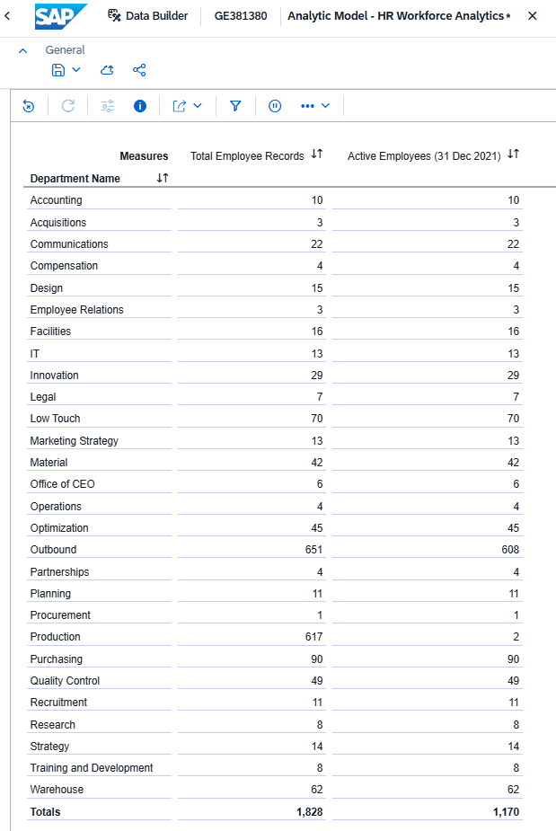
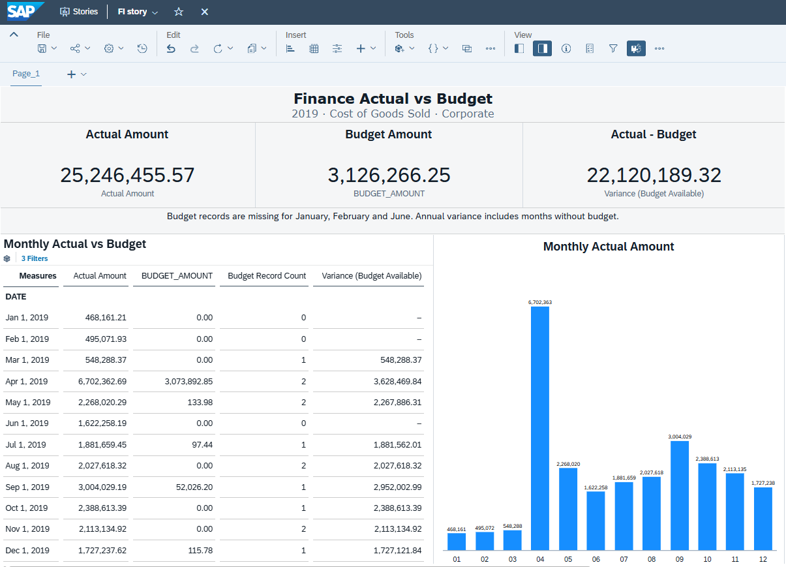
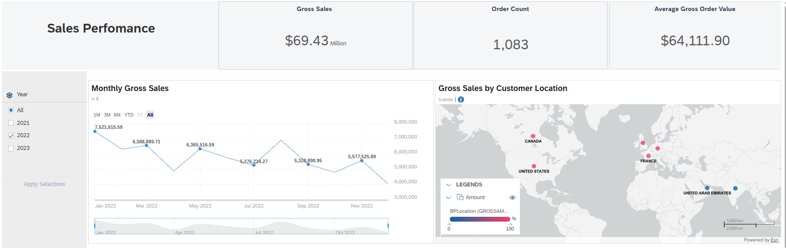
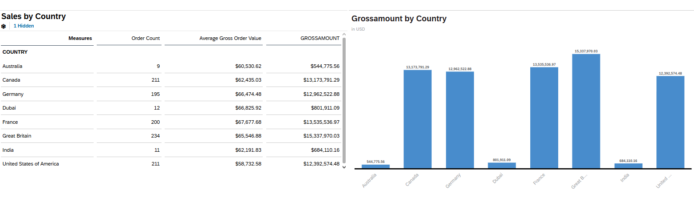

# SAP Datasphere Analytics Portfolio

Three analytics scenarios built with SAP sample data: workforce reporting, actual-versus-budget analysis, and sales performance. The project covers data modeling, calculated KPIs, data-quality checks, and interpretation of results.

**Stack:** SAP Datasphere · SAP Analytics Cloud · Graphical Fact Views · Analytic Models · CSV · CSN/JSON

## My contribution

Built the HR and Finance views and analytic models, configured joins and text filters, and checked results against the source data. Extended an existing Sales tutorial model and SAC Story with order KPIs, monthly trends, and country analysis.

| Scenario | Main result | Details |
| --- | --- | --- |
| HR | 1,170 active employees on 31 Dec 2021 under the defined rule; 24 unmatched personal-data records identified | [Model, formulas & checks](docs/hr.md) |
| Finance | Distinguished missing budget records from recorded zeros before calculating variance | [Model, formulas & checks](docs/finance.md) |
| Sales | 2022 gross sales fell 0.92% while order count rose 0.28%; Germany contributed the largest decline | [KPIs & analysis](docs/sales.md) |

## HR — Workforce

Combined four sources to report employee records and active headcount by department. Left joins preserve employees with missing descriptive data.

[Analytic model JSON](Models/HR%20MODEL/HR_Workforce_Analytics.json)

## Finance — Actual vs Budget

Added a budget-record count and a guarded variance: missing budget produces a blank result, while a recorded zero remains comparable. Coverage is checked at the current grouping level.

The SAC dashboard shows annual KPI cards, monthly budget availability, and actual costs for Corporate cost of goods sold in 2019. Its warning highlights the incomplete budget coverage.

[Analytic model JSON](Models/FI%20MODEL/FI_ACTUAL_VS_BUDGET_ANALYTICS.json)

## Sales — Performance Dashboard

Adapted a SAC Story with three KPI cards, monthly gross sales, a customer-location map, and a country table with a comparison chart. Year-filter checks matched Datasphere for 2021 and 2022; incomplete 2023 is excluded from the annual comparison. Both screenshots show 2022.

[Analytic model JSON](Models/SALES%20MODEL/Sales_Analytic_Model.json) · [Story details and validation](docs/sales.md#sap-analytics-cloud-story)

## Explore the project

- **[HR documentation](docs/hr.md), [Finance documentation](docs/finance.md), [Sales documentation](docs/sales.md):** architecture, formulas, assumptions, validation, and reproduction steps.
- **[Models](Models/):** model exports and saved Finance/Sales Preview configurations.
- **[Screenshots](Screenshots/):** model diagrams and analytical results.
- **[HR](HR/), [FI](FI/), [Sales](Sales/):** sample CSV inputs.

Exports contain definitions, not loaded data. A fresh-tenant import has not been tested; Sales also requires remote-source and tutorial dependencies. HR and Finance results were reconciled to local CSVs; Sales checks cover exported formulas and screenshot arithmetic. See the [publication review](docs/publication-review.md).

## Data & attribution

This learning project uses public [SAP sample content](https://github.com/SAP-samples/datasphere-content/tree/main/SAP_Sample_Content). All 10 included CSVs were matched to upstream content after encoding and whitespace normalization. See [third-party notices](THIRD_PARTY_NOTICES.md) and the included [Apache-2.0 license](LICENSES/Apache-2.0.txt).

