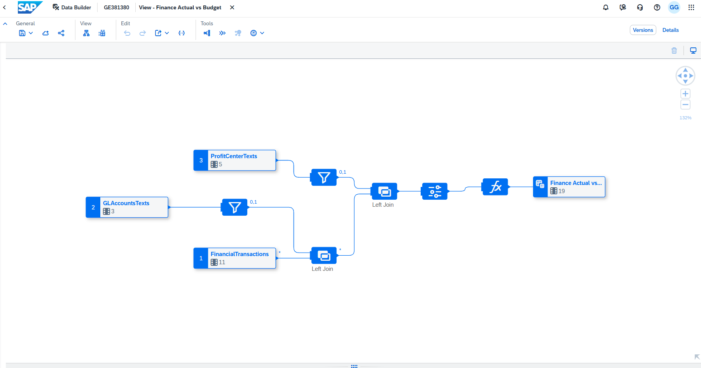
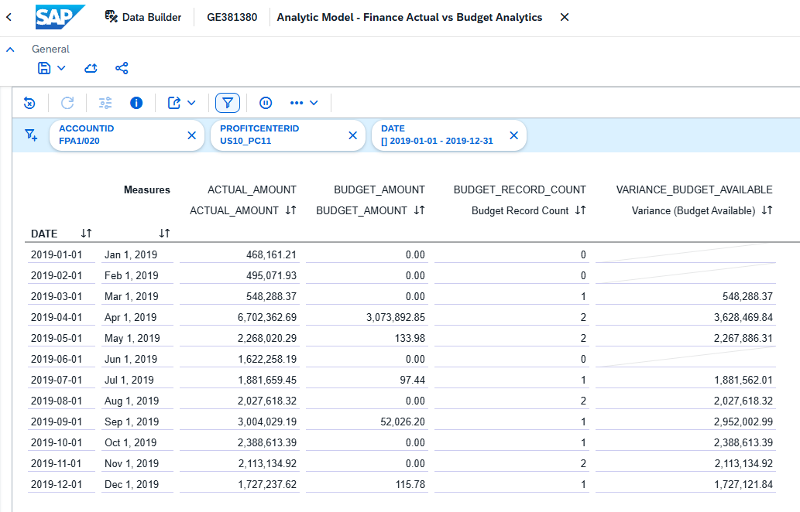

# Finance Actual vs Budget

[Back to portfolio](../README.md)

Business question: how do actual and budget amounts compare by account, profit center, and month, and when is a variance unsupported because budget records are missing?

## Architecture and source data

`FI_ACTUAL_VS_BUDGET` is a graphical Fact view consumed by `FI_ACTUAL_VS_BUDGET_ANALYTICS`.

| Local table | Source CSV | Role |
| --- | --- | --- |
| FI_FINANCIAL_TRANSACTIONS | FI/FinancialTransactions.csv | Base records keyed by TRANSACTIONID |
| FI_ACCOUNT_TEXTS | FI/GLAccountsTexts.csv | Account descriptions, joined on ACCOUNTID |
| FI_PROFIT_CENTER_TEXTS | FI/ProfitCenterTexts.csv | Profit center descriptions, joined on PROFITCENTERID |

Both text sources are filtered to LANGUAGE = 'EN' before left joins. The account text import retains ACCOUNTID, LANGUAGE, and MEDIUM_DESCR; the profit center text import retains all five source columns. Text table keys use ID plus LANGUAGE. The projection exposes Account Name and Profit Center Name separately. Profit center names are not unique, so analyses use their IDs as well.

The transaction CSV has 167,136 unique transaction IDs: 64,756 Actual records and 102,380 Budget records. The SAP preview retained 167,136 rows after joins. Dates range from April 2018 to January 2021; this does not imply equal coverage of the two versions. The example selects calendar year 2019, which has records for both versions in each month at dataset level. Coverage must still be checked within each account and profit center.

## Measures

| Measure | Definition |
| --- | --- |
| ACTUAL_AMOUNT | SUM of VALUE where VERSION = 'Actual', otherwise 0 |
| BUDGET_AMOUNT | SUM of VALUE where VERSION = 'Budget', otherwise 0 |
| Budget Record Count | SUM of 1 where VERSION = 'Budget', otherwise 0 |
| Variance (Actual - Budget) | Aggregated Actual Amount minus Budget Amount |
| Variance (Budget Available) | Same difference when aggregated Budget Record Count > 0; otherwise NULL |

The two amount columns use Decimal(38,19); the record count uses Integer. All three base measures aggregate with SUM. The two variance measures are calculated in the analytic model.

Budget availability is checked **at the current grouping level**. A positive count does not prove that every underlying month, product, or customer has budget coverage. A yearly calculation can return a variance even when some months lack budget. This measure is not a sum restricted to comparable months, and it does not check for missing Actual records.

## Validated example: Corporate cost of goods sold, 2019

Filters: DATE from 2019-01-01 through 2019-12-31, ACCOUNTID = `FPA1/020`, PROFITCENTERID = `US10_PC11`. Rows: DATE. Display Actual Amount, Budget Amount, Budget Record Count, and Variance (Budget Available).

| Scope | Actual | Budget | Arithmetic difference |
| --- | ---: | ---: | ---: |
| Cost of Goods Sold, all profit centers, 2019 | 287,973,509.29 | 265,853,319.97 | 22,120,189.32 |
| Corporate, same account and year | 25,246,455.57 | 3,126,266.25 | 22,120,189.32 |

All 11 account-level rows in the 2019 SAP preview were reconciled to local CSV calculations. Corporate's monthly values were also checked against the source. January, February, and June have **no Budget records** for this account and center; March has one Budget record with value zero. The guarded variance is consequently blank for the three missing months but returns 548,288.37 for March.

This distinguishes a recorded zero from absent data. The annual arithmetic difference should not be described as confirmed overspending against a complete budget. Currency is not provided in the transaction file, so amounts are shown without a currency symbol. Signs are preserved, including negative sales deductions. Summing all accounts does not by itself yield profit; this project does not define a profit or turnover KPI.

## SAP Analytics Cloud dashboard

The saved `FI story` presents the 2019 Corporate cost-of-goods-sold example with three KPI cards, a monthly table, and a single-series Actual Amount column chart. Widget filters select 2019, `FPA1/020`, and `US10_PC11`. The screenshot values match the validated example above; interactive filter changes have not been tested for this Story.

The cards show Actual 25,246,455.57, Budget 3,126,266.25, and annual difference 22,120,189.32. A visible warning explains the missing January, February, and June budget records and the annual calculation's inclusion of those months. The table keeps Budget Record Count and the guarded monthly variance visible. The chart shows actual costs only; April is the largest month at 6,702,362.69. The data shown does not explain the cause of that peak.

The Fact view adds `MONTH` (label Month), calculated with `TO_VARCHAR("DATE", 'MM')`. The chart uses labels 01–12 in ascending order while retaining the 2019 DATE filter; using Month without a year filter would combine years. Both refreshed exports contain this field. Its exported type is String(5000), although the formula returns two-character month labels.

The Story is documented by this screenshot, not a SAC transport package or public URL. Importing the Datasphere JSON does not recreate the Story layout.

## Exports and reproduction

- [Fact view export](../Models/FI%20MODEL/FI_ACTUAL_VS_BUDGET.json).
- [Analytic model export](../Models/FI%20MODEL/FI_ACTUAL_VS_BUDGET_ANALYTICS.json), including the Fact view and three table definitions.
- [Preview settings](../Models/FI%20MODEL/FI_ACTUAL_VS_BUDGET_ANALYTICS_Preview.json), containing the three example filters, DATE on Rows, four selected measures, two decimal places for amounts, and zero decimal places for the record count.

All three files parse as JSON; the Fact view definition embedded in the analytic export matches the standalone export. The variance formula includes the NULL branch. These are file-level checks; importing the exports and restoring Preview settings in another tenant have not been tested. Preview settings include source-system identifiers and are separate from the model definition, so portability is not assumed.

To reproduce, import the analytic CSN into a suitable space and review object conflicts, load the three corresponding CSVs, and deploy the required objects. FinancialTransactions uses a semicolon delimiter; the text files use commas. Parse DATE as YYYYMMDD and retain decimal precision for VALUE. Recreate the filters and layout above manually if Preview settings cannot be imported. CSN files do not include table rows.
