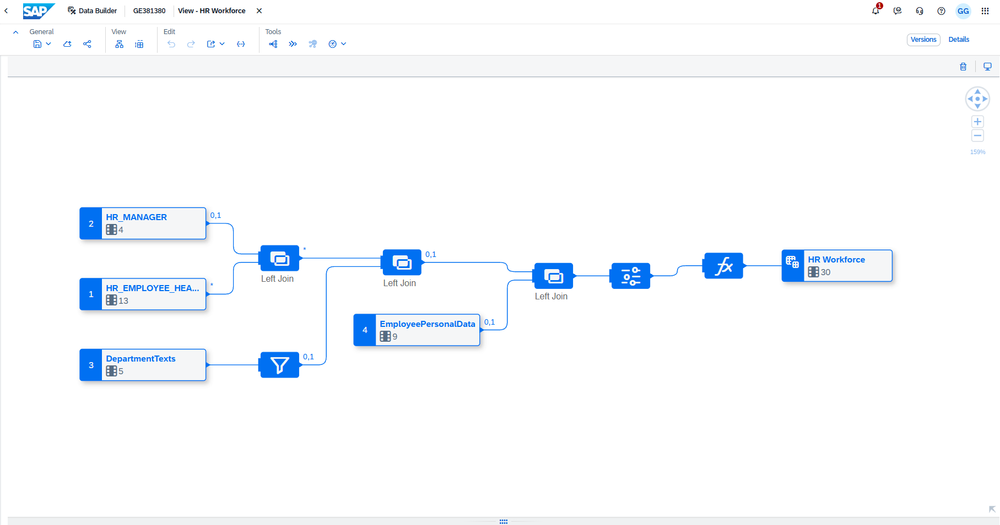

# HR Workforce Analytics

[Back to portfolio](../README.md)

Business question: how many employee records belong to each department and manager, and how many employees meet the project's active-employment rule on 31 December 2021?

This is a training project using [SAP Sample Content for FI, HR and SD](https://github.com/SAP-samples/datasphere-content/tree/main/SAP_Sample_Content), not a production workforce report. The custom work consists of the graphical workforce view, joins and English text filter, explicit reporting-date calculation, analytic model, and reconciliation checks.

## Results

| Metric | Result |
| --- | ---: |
| Total employee records | 1,828 |
| Active employees on 31 Dec 2021 under the stated rule | 1,170 |
| Records excluded by that rule | 658 |
| FTE across all records, including former employees | 1,828 |

The 658 excluded records span the dataset's employment history; this is not the number of exits during 2021 and is not a turnover rate. Production accounts for 615 excluded records and Outbound for 43. These patterns describe sample data only.


## Architecture

Four local tables feed `HR_WORKFORCE`, a graphical view with semantic usage **Fact**. `HR_Workforce_Analytics` consumes this view.

| Local table | Source CSV | Rows | Join/key |
| --- | --- | ---: | --- |
| HR_EMPLOYEE_HEADCOUNT | HR/EmployeeHeadcount.csv | 1,828 | EMPLOYEEID, base grain |
| HR_MANAGER | HR/HRManager.csv | 24 | MANAGERID |
| HR_DEPARTMENT_TEXTS | HR/DepartmentTexts.csv | 28 | DEPARTMENTID and LANGUAGE; filter LANGUAGE = 'EN' before joining |
| HR_EMPLOYEE_PERSONAL_DATA | HR/EmployeePersonalData.csv | 1,828 | EMPLOYEEID |

All three joins are left joins, preserving employee records without matching descriptive data. The grain is one row per employee ID in this dataset. Manager and employee names are kept separate. Department and manager grouping uses the assignments present in the source; historical department transfers and manager changes cannot be reconstructed from these files.



## Measures and assumptions

- **Total Employee Records:** constant `1` per employee row, aggregated with SUM. The source view calls this measure `Employee Count`; the analytic model supplies the presentation label.
- **FTE:** source FTE aggregated with SUM. This measure includes all records, not just active employees. Decimal storage is retained for fractional employment; the displayed precision is a presentation setting.
- **Active Employees (31 Dec 2021):** Integer flag aggregated with SUM. The exported technical name is `Active_Employees_31_Dec_2021`.

```sql
CASE
    WHEN "DATE" <= TO_DATE('2021-12-31', 'YYYY-MM-DD')
     AND "EXITDATE" > TO_DATE('2021-12-31', 'YYYY-MM-DD')
    THEN 1
    ELSE 0
END
```

For this exercise, DATE is interpreted as employment start and EXITDATE as the first inactive day. These are explicit project assumptions, not definitions confirmed by the sample README. The reporting date is fixed, not a user-selectable parameter. The recurring 2099-12-31 value is treated as an open-ended employment marker. No claim is made about current employment today.

Salary is not used as a monetary KPI because its currency and payment period have not been established. Employment dates alone do not establish historical salary or organizational assignments.

## Validation and known data issue

Local CSV checks on 16 October 2026 found:

- 1,828 unique, nonduplicated employee IDs in the headcount source.
- Unique manager IDs, employee IDs in personal data, and department IDs after the English filter.
- No unmatched manager or English department references from headcount.
- **24 headcount employee IDs have no matching personal-data record**, despite both files having 1,828 rows. Their descriptive personal fields remain null after the left join. Do not drop these employees or join by name to conceal this issue.
- No missing DATE/EXITDATE values and no start dates later than exit dates in the checked file.
- The fixed-date rule returns 1,170 locally, matching the user-verified SAP analytic preview. The SAP view preview retains 1,828 rows after joins.

Both exported JSON files parse successfully. Their definitions include the three left-join conditions, the fixed-date calculation, and SUM aggregations for the three measures. An import into a clean SAP space has not been tested. The summary screenshot was captured with an unsaved-change indicator; the exported analytic model independently contains the displayed measure labels.

## Files and reproduction

- [Graphical view export](../Models/HR%20MODEL/HR_WORKFORCE.json): the view and its four source-table definitions.
- [Analytic model export](../Models/HR%20MODEL/HR_Workforce_Analytics.json): the analytic model, workforce view, and four source-table definitions.
- `HR/`: original sample CSVs; this scenario uses the four listed above.
- `Screenshots/`: graphical model and analytical result.
- `FI/` and `Sales/`: sample source files for the other scenarios.

In a suitable SAP Datasphere space, import the analytic-model CSN/JSON and review the dependency list and object-name conflicts. It includes the workforce view and local-table definitions, so importing the separate graphical-view export as well is normally unnecessary. Load each of the four CSVs into its corresponding table, preserving IDs as strings, dates in YYYYMMDD format, and FTE as a decimal. EmployeeHeadcount and EmployeePersonalData use semicolons; HRManager and DepartmentTexts use commas. Deploy required objects and the analytic model, then reproduce the department summary in Preview with Department Name in Rows and the two employee-count measures in Columns. Reconcile the totals before interpreting the results.

CSN exports contain definitions, not table data or a standalone SAC dashboard. See [SAP's export documentation](https://help.sap.com/docs/SAP_DATASPHERE/c8a54ee704e94e15926551293243fd1d/391610123f1f4a12abb12cbf77a3294d.html). Availability of import and deployment depends on tenant permissions.
