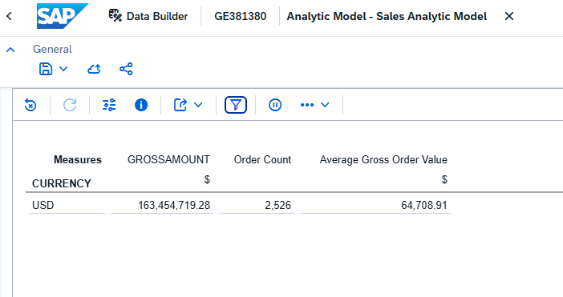
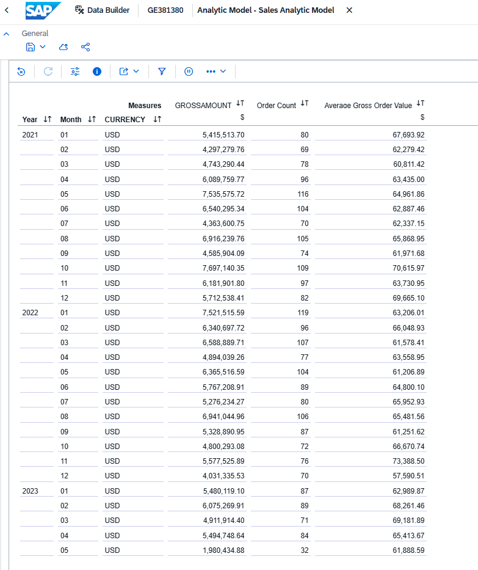
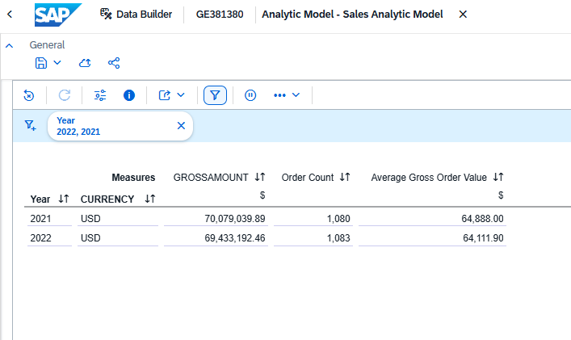
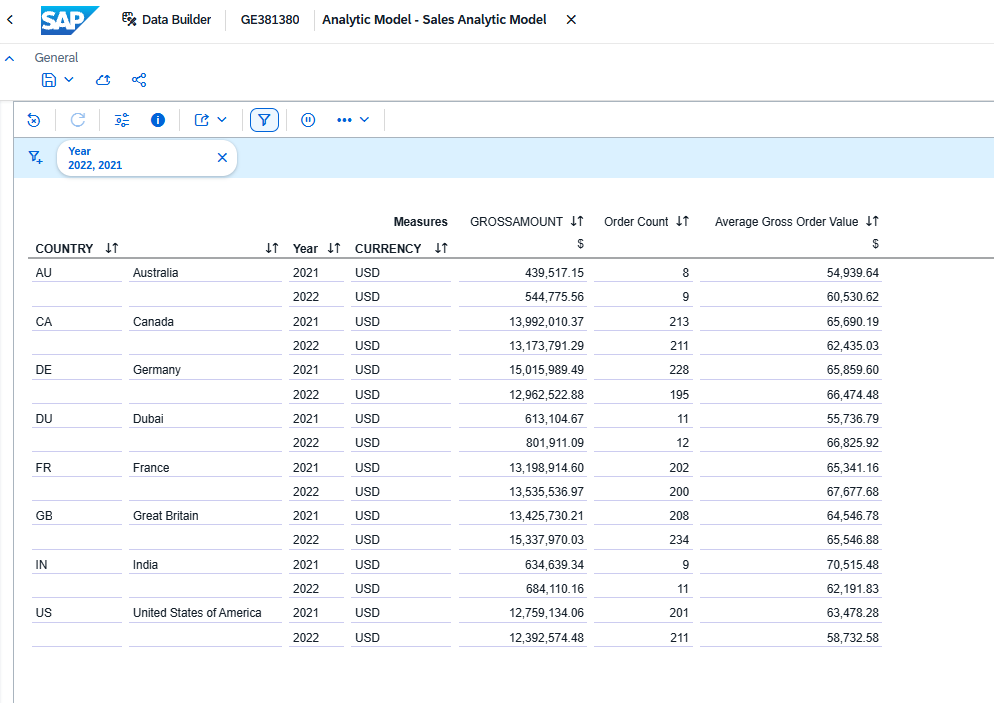

# Sales Analytics

[Back to portfolio](../README.md)

Business question: how did gross sales, distinct orders, and average gross order value change between 2021 and 2022, and which customer countries contributed to the change?

## Model and measures

The existing tutorial `Sales_Analytic_Model` consumes `Sales_Fact`, which joins order headers to order items on SALESORDERID. The intended grain is one sales-order item. Gross amounts come from the item source; counting fact rows would count items rather than orders. Associations provide product, business partner, address/country, and calendar attributes. Country describes the associated customer address, not necessarily the delivery destination.

This portfolio extends that model with two measures:

| Measure | Definition | Display |
| --- | --- | --- |
| GROSSAMOUNT (existing) | SUM of item gross amounts, grouped by currency | 2 decimals |
| Order Count | COUNT DISTINCT of SALESORDERID | 0 decimals |
| Average Gross Order Value | GROSSAMOUNT / Order Count when Order Count > 0; otherwise NULL | 2 decimals |

The average is calculated from aggregated amounts and distinct orders at the current grouping level. It is not an average item price or an unweighted average of monthly averages. Keep CURRENCY in the analysis; the captured results contain USD only and do not demonstrate currency conversion. Distinct order counts are not generally additive across product groups when an order contains multiple products.

The captured summary reports gross sales of 163,454,719.28 USD across 2,526 distinct orders, giving 64,708.91 USD per order. This is the captured model selection, not a claim about all source history.

## Comparable periods

The monthly preview shows January–December for 2021 and 2022, but only January–May for 2023. A subsequent descending daily preview for 2023 showed the latest available order date as **15 May 2023**. Consequently, 2023 is excluded from the main annual comparison. Comparing January–May 2023 with five complete months in earlier years would also include an incomplete month. The date check establishes observed model coverage, not independent proof of source-load completeness.

## Annual comparison: 2021 vs 2022

Filter Year to 2021 and 2022 without a month filter. Rows: Year, CURRENCY. Columns: the three measures above.

| Metric | 2021 | 2022 | Change |
| --- | ---: | ---: | ---: |
| Gross sales (USD) | 70,079,039.89 | 69,433,192.46 | -0.92% |
| Distinct orders | 1,080 | 1,083 | +0.28% |
| Average gross order value (USD) | 64,888.00 | 64,111.90 | -1.20% |

Order volume was nearly unchanged. A lower average gross order value accounts arithmetically for the slight decline in gross sales; this does not establish a change in product prices or its business cause.

## Country contribution

Keep the same year filter and use Country, Year, CURRENCY on Rows, with years sorted ascending within each country.

| Country label in sample | Gross-sales change, 2022 minus 2021 (USD) |
| --- | ---: |
| Australia | +105,258.41 |
| Canada | -818,219.08 |
| Germany | -2,053,466.61 |
| Dubai (sample code DU) | +188,806.42 |
| France | +336,622.37 |
| Great Britain | +1,912,239.82 |
| India | +49,470.82 |
| United States of America | -366,559.58 |
| **Total** | **-645,847.43** |

Germany contributes the largest decline: orders fell from 228 to 195 despite a higher average order value. Great Britain offsets much of that decline. In the United States, orders rose from 201 to 211 while average order value fell from 63,478.28 to 58,732.58 USD. Country labels are preserved from the sample, including its nonstandard DU/Dubai entry.

## SAP Analytics Cloud Story

The existing tutorial Story `GE381380_Sales_Analytics_Visualization` was adapted into **Sales Performance**, using `Sales_Analytic_Model` as its data source. The new Datasphere measures are available directly in the Story.

- Three numeric KPI cards: Gross Sales (million USD), Order Count (integer), and Average Gross Order Value (USD, two decimal places).
- Monthly Gross Sales: a time-series chart using OrderCreationDate at Month level.
- Gross Sales by Customer Location: the existing geographical view, with a clearer title.
- Sales by Country: all eight sample country labels with the three measures.
- Year input control linked to the page widgets. The captured view selects 2022.

### Interaction checks

During the guided SAP session on 17 October 2026, the user confirmed that switching Year between 2021 and 2022 updates all three KPI cards. The expected values match the annual comparison above: 2022 displays 69.43 million USD, 1,083 orders, and 64,111.90 USD per order; 2021 displays 70.08 million USD, 1,080 orders, and 64,888.00 USD per order.

The user also confirmed that the Germany map tooltip changes from 12,962,522.88 USD in 2022 to 15,015,989.49 USD in 2021. The saved country screenshot shows all eight rows and complete monetary values. These are interactive user-confirmed checks and screenshot evidence, not automated SAC tests.

The screenshot's map extent does not include Australia, although Australia is included in the table and KPI totals. Its color legend is displayed as a percentage scale; monetary values should be read from tooltips or the table. The incomplete 2023 coverage described above also applies to the Story.

The repository contains screenshots of the saved Story, not a SAC transport/export package or a publicly accessible dashboard. To recreate it, use the available Sales model in SAC, configure the widgets above, link the Year control to all relevant widgets, and verify the annual totals. Datasphere CSN and Preview settings do not recreate the SAC Story layout.

## Exports, validation, and reproduction

- [Updated analytic model export](../Models/SALES%20MODEL/Sales_Analytic_Model.json), including dependency definitions.
- [Country-comparison Preview settings](../Models/SALES%20MODEL/Sales_Analytic_Model_Preview.json): Country, Year, CURRENCY on Rows; 2021 and 2022 selected; three KPI measures selected.
- The four Sales screenshots above preserve the summary, monthly, annual, and country layouts. Only one Sales Preview settings file is currently included.

Both JSON files parse successfully. The model export confirms COUNT_DISTINCT on SALESORDERID, the guarded average formula, and formatting of zero/two decimal places respectively. Screenshot-derived country changes reconcile to the annual change, and gross amount divided by distinct orders reconciles to the displayed averages. Sales results have not been independently reconciled to local CSV rows or a fresh tenant import.

To reproduce in the configured tenant, deploy the updated model, select GROSSAMOUNT, Order Count, and Average Gross Order Value, and apply the layouts and filters described above. Review model variables as well as visible Preview filters: the tutorial model contains a year-range variable and a domestic-country parameter. For the annual and country views, explicitly select 2021 and 2022 and remove month/day filters.

The export includes dependencies on remote sources, product/category content, and SAP time objects. The local `Sales/` files alone are not a complete standalone reconstruction of that environment. Review connections and dependencies before importing into another space. JSON contains model definitions rather than table rows; Preview settings contain source-system identifiers, and restoring them in another tenant has not been tested.
